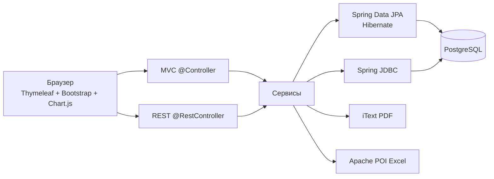

# FinTracker

Учебное веб-приложение для мониторинга доходов и расходов и генерации отчётов. Сделано по кейсу Globus IT: Spring Boot, серверные шаблоны, REST API, PostgreSQL.

## Архитектура



Слои:

- веб: `@Controller` отдаёт страницы, `@RestController` — JSON и файлы отчётов;
- сервисы: бизнес-логика, IoC/DI через конструкторы;
- данные: CRUD через JPA, агрегаты дашборда через `JdbcTemplate`;
- безопасность: Spring Security, форма логина, BCrypt.

## Технологии

- Java 11+, Spring Boot 2.7, Maven
- Spring MVC, Thymeleaf, Spring Security, Spring Data JPA, Spring JDBC, Hibernate
- PostgreSQL, iText, Apache POI, Chart.js, Bootstrap 5
- JUnit 5, Mockito, MockMvc

## Запуск одной командой

Нужны Docker, JDK 11+ и Maven.

Из корня проекта:

```bash
docker compose -f pg-docker-compose.yaml up -d && mvn spring-boot:run
```

Приложение: [http://localhost:8080](http://localhost:8080)

Демо-вход: `demo@globusit.local` / `demo123`

PostgreSQL из `pg-docker-compose.yaml`: пользователь `postgres`, пароль `postgres`, БД `postgres`, порт `5432`.

Остановка: `Ctrl+C`, затем `docker compose -f pg-docker-compose.yaml down`.

## Тесты

```bash
mvn test
```

Юнит-тесты сервисов (JUnit + Mockito) и интеграционные тесты контроллеров/API (MockMvc).

## Сборка JAR

```bash
mvn -DskipTests package
java -jar target/fintracker-1.0.0.jar
```

Перед запуском JAR PostgreSQL должен быть доступен.

## Страницы и API

| Метод | Путь | Назначение |
| --- | --- | --- |
| GET | `/dashboard` | метрики и графики |
| GET/POST | `/transactions` | список и добавление |
| GET | `/reports` | предпросмотр отчёта |
| GET | `/categories` | категории |
| GET | `/profile` | настройки пользователя |
| GET | `/api/transactions` | JSON список |
| POST | `/api/transactions` | AJAX-добавление |
| GET | `/api/reports/export` | PDF/Excel |
| GET | `/api/analytics/metrics` | метрики дашборда |

Интерфейс работает без JavaScript (обычные формы). С JS: валидация, уведомления, модальное окно, Chart.js, AJAX.

## Сущности

- `User` — id, имя, email, дата регистрации
- `Transaction` — сумма, тип, категория, дата, описание, пользователь
- `Category` — название, тип (доход/расход)
- `Report` — период, тип (месяц/квартал/год), дата генерации, пользователь
